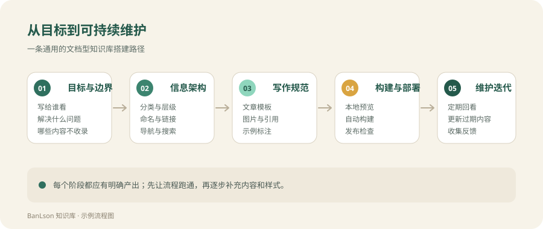

# 示例：文档型知识库搭建流程

<div class="example-notice">
  <strong>示例文章</strong>
  <span>本文用于展示实践案例的写作与排版方式，描述的是通用流程，不代表 BanLson 的个人经历。</span>
</div>

假设一个通用场景：你希望把分散在文档、聊天记录和脑子里的资料，整理成一个可以长期维护、方便检索的网站。内容不算多，但希望结构清楚、写作成本低、以后还能持续更新。

下面是一条从零开始的最小可行路径。它不追求一步到位，而是先把流程跑通，再逐步补内容。



## 第一步：明确目标与边界

在选工具之前，先回答几个问题：

| 问题 | 作用 |
| --- | --- |
| 主要读者是谁？ | 决定内容的深度和表达方式 |
| 最常查什么？ | 决定导航和搜索的优先级 |
| 哪些内容必须收录？ | 确定第一版范围 |
| 哪些内容不收录？ | 避免知识库变成杂物间 |
| 谁来维护、多久更新一次？ | 决定流程的复杂度 |

第一版不需要覆盖所有主题。一个可用的范围可以写成：

> 收录与工作方法、常用工具和项目实践相关的内容；不收录临时聊天记录、未经验证的传闻和与主题无关的收藏。

边界越清楚，后面越不容易因为「什么都想放」而停滞。

## 第二步：设计信息架构

信息架构的核心是让人知道「现在在哪、下一步去哪」。可以从三个层次考虑：

1. **顶部导航**：放最重要的 3～5 个分类，不要把所有页面都塞进去。
2. **左侧目录**：展示当前分类下的文章，层级尽量控制在两层。
3. **正文与右侧目录**：正文按标题组织，右侧目录用于在当前页内跳转。

分类命名建议：

- 使用读者熟悉的词，而不是内部缩写
- 同一层级保持同一维度，例如都按「内容类型」划分
- 分类数量少一点，宁可先合并，也不要一开始就建很多空分类
- URL 使用简短的英文或拼音，标题可以使用中文

一个常见的分类方式是：

- **学习笔记**：概念、方法和复盘
- **工具使用**：安装、配置、操作和排错
- **实践案例**：完整项目或流程记录

如果某篇文章同时属于多个分类，优先放到最主要的一个，再通过相关阅读链接过去，避免重复维护。

## 第三步：建立写作规范

写作规范不需要很复杂，但最好在开始写之前定下来，否则后期统一格式的成本会很高。

### 文章模板

每篇文章至少包含：

```md
---
title: 文章标题
description: 一句话说明这篇文章解决什么问题
---

# 文章标题

（开头说明背景和适用范围）

## 正文小节

...
```

### 内容约定

- **标题**：尽量包含读者会搜索的关键词
- **开头**：说明这篇内容解决什么问题、适合谁看
- **步骤**：按「操作—预期结果」写，命令放进代码块
- **图片**：配上说明文字，文件名使用有意义的英文
- **来源**：引用外部资料时保留链接和版本
- **示例**：如果内容是演示或占位，明确标注「示例」

### 示例内容要标注

示例可以帮助读者理解排版，但如果不标注，容易被误认为真实经历或已验证结论。建议在文章开头使用统一的提示块，并在分类页说明示例数量。

## 第四步：搭建与部署

工具选择可以根据团队熟悉程度决定。对以 Markdown 为主、需要文档布局和本地搜索的个人知识库，VitePress 是一个轻量选择。

一个典型的搭建顺序：

1. 初始化项目，确定 Node.js 版本和依赖版本。
2. 配置站点名称、描述、导航、侧栏和搜索。
3. 建立内容目录，先写 3 篇示例文章。
4. 本地运行开发服务器，检查桌面端和手机端布局。
5. 执行生产构建，修复链接和资源错误。
6. 配置自动构建与部署流程。
7. 在托管平台启用 Pages，并确认访问地址。

部署前建议检查：

- [ ] 站点标题、描述和图标正确
- [ ] 导航链接没有 404
- [ ] 左侧目录与实际文章一致
- [ ] 图片在浅色和深色模式下都能看清
- [ ] 手机宽度下正文可以正常阅读
- [ ] 搜索能返回中文和英文结果
- [ ] 构建命令在干净环境中可以完成

如果把站点部署在子路径下，还需要正确设置 `base`。使用自定义域名或用户主页根路径时，通常是 `/`；具体以托管平台的说明为准。

## 第五步：维护与迭代

知识库真正的成本不在第一次搭建，而在之后的维护。可以建立一些轻量机制：

- **固定入口**：所有文章都能从导航或分类页到达
- **定期回看**：每月检查一次失效链接、过期版本和未完成文章
- **合并重复**：同一主题只保留一篇主文章，其他位置链接过去
- **记录变更**：重要结论变化时更新文章，而不是另开一篇相似的
- **保留反馈入口**：让读者可以指出错误或补充信息

如果使用 Git 管理内容，每次修改都有记录，回滚和对比会比较方便。提交信息建议写清楚改了什么，例如「新增：本地搜索配置说明」。

## 验收清单

| 阶段 | 最小产出 |
| --- | --- |
| 目标与边界 | 一段范围说明和读者定义 |
| 信息架构 | 导航、分类和侧栏结构 |
| 写作规范 | 文章模板和示例标注规则 |
| 构建与部署 | 可重复执行的构建、发布流程 |
| 维护迭代 | 定期检查和更新机制 |

## 常见风险

**分类越建越多。** 空分类会让导航显得复杂。先写内容，等某一类文章足够多再拆分。

**示例被当成事实。** 演示内容要明确标注，避免读者误以为已经验证。

**只搭框架不写内容。** 先完成三篇能解决实际问题的文章，比先做一套复杂主题更有价值。

**发布后不维护。** 工具版本、命令参数和外部链接都会变化，至少保留一个定期检查的习惯。

## 相关阅读

- [实践案例分类说明](./index.md)
- [示例：用四步法整理主题笔记](../notes/example-study-note.md)
- [站点维护说明](../guide/maintenance.md)
